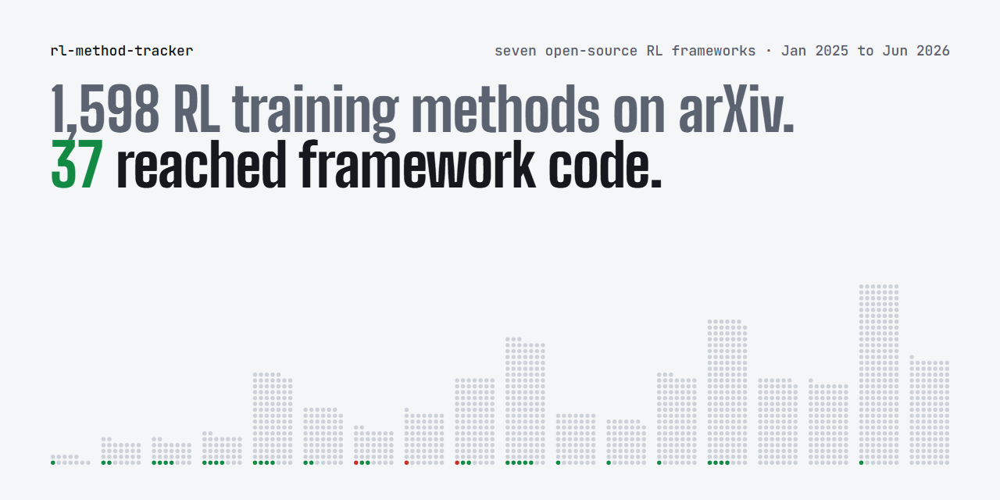

# RL post-training method inclusion tracker

[](https://doi.org/10.5281/zenodo.23495743)

[](https://pth2002.github.io/rl-method-tracker/)

Hundreds of RL objectives for language models were published in 2025 and 2026. This repository
tracks which of them the main open-source training frameworks include, from the day each one
landed on a main branch to how it is offered today. The
[project page](https://pth2002.github.io/rl-method-tracker/) shows every paper in the pool, the
methods for each training failure, the latest landings and each framework's record.

The technical report *From RL Papers to Framework Code: Inclusion and Review in Seven Open-Source
Training Frameworks* (version 1, 20 October 2026) is at [paper/main.pdf](paper/main.pdf). Code is under
the MIT License and data under CC BY 4.0 ([LICENSE](LICENSE), [LICENSE-DATA](LICENSE-DATA)); cite with
[CITATION.cff](CITATION.cff). The archived release has the DOI
[10.5281/zenodo.23495743](https://doi.org/10.5281/zenodo.23495743), which always resolves to the latest
version; version 1.0, the release behind the report, is
[10.5281/zenodo.23495744](https://doi.org/10.5281/zenodo.23495744).

A method counts as **included** when its implementation reaches the main branch of a tracked
framework. Inclusion is a property of the code frameworks ship. It is not a record of how often
users enable a method or what it achieves.

- **[INDEX.md](INDEX.md)** is the practitioner view: training failures (entropy collapse, length bias,
  rollout-training mismatch, MoE instability, ...) and the methods that address each one, with the
  frameworks that include them and how they are offered.
- **`data/generated/adoption.csv`** is the analysis view: one row per method with source date, first
  landing per framework, lag in days, tier today and how the introducing commit's author relates to
  the paper's author list.

Frameworks covered: verl (with verl-recipe), TRL, OpenRLHF, NeMo-RL, ROLL, slime, AReaL.

## What you can do with it

- **You see a training failure.** `INDEX.md` groups methods by the failure their source paper says
  they address. Each entry links to the file and line where the framework implements it, at the
  commit the report analysed. The index lists implementations and does not test whether a method helps.
- **You want a framework to include your method.** `FRAMEWORKS.md` links each framework's contribution
  rules, shows where its RL algorithms live, lists the pull requests that brought recent methods in
  and what review raised in them, and lists earlier public proposals with their outcomes.
- **You study inclusion.** `python tools/reproduce_report.py --pdf` rebuilds every number, table and
  figure of the report from the frozen inputs in `data/` without network access. The table below
  leads from each part of the report to its rows.
- **Something is wrong.** Open an issue with the correction template and link the evidence.

## From the report to the data

Every number in the text is a macro in `paper/numbers.tex`, written by `tools/paper_numbers.py`. Paths are
under `data/generated/` unless they start with `data/` or `config/`.

| Report | One row per | Files |
|---|---|---|
| Pool and labels (Section 4, Appendix A) | screened paper (6,939) | `arxiv_frame.jsonl` (metadata), `triage/labels.jsonl` (label with its evidence), `pool_adoption.jsonl` (label, scope and inclusion), rules in `config/triage_rules.md` |
| Manual review (Appendix B) | sampled paper | `triage/review_sample.csv`, `triage/validation.md`, `data/release/triage_manifest.json` |
| Model reports read in full (Section 4) | report | `casecontrol/report_filled.jsonl`, `casecontrol/report_scope.jsonl` |
| Inclusion and lags (Sections 3 and 5) | option event, method | `framework_events.jsonl`, `adoption.json`, `adoption.csv`, mappings in `config/token_map.yaml` |
| Citation audit (Section 3) | paper, framework and file | `process/citation_audit.jsonl`, `github/code_citations.jsonl` |
| Included and not included papers (Section 6, Appendix C) | paper | sample in `data/release/casecontrol_key.json`, codes in `casecontrol/cc_v1_filled.jsonl` and `casecontrol/cc_v1_audit_added.jsonl`, blind recodes in `casecontrol/cc_v1_blind_recode*.jsonl` with keys in `data/release/blind_recode*_key.json` |
| Landings and their pull requests (Section 7) | landing, pull request | `process/landings.jsonl`, `github/pr_facts.jsonl`, `github/merged_prs.jsonl` |
| Proposals and review (Section 7, Appendix E) | thread | `process/attempts_coded.jsonl`, `process/attempt_replies.jsonl`, `process/landing_prs_coded.jsonl`, `process/attempts_round6_coded.jsonl`, agreement in `process/agreement.md` |
| Public record of all papers (Figure 1c) | thread, mention | `github/threads.jsonl`, `github/mentions.jsonl` |
| Supply and inclusion by quarter (Figure 1b) | quarter | `quarterly.json` |
| Methods stated in large model reports (Section 9) | report | `casecontrol/model_reports.jsonl` (methods, framework stated, one quote each) |
| Failures that users report (Section 8) | thread | `process/issue_failures.jsonl` (screened threads with codes), `process/issue_recall_sample.jsonl` |

## How inclusion is measured

Every date comes from the framework's own git history on its main branch (`--first-parent`), as an
approximation of the day a change became available there. Each framework exposes its algorithms in a
few places (an advantage-estimator registry, a loss-type list, configuration switches, example
configurations, recipe folders). `config/frameworks.yaml` lists those places and
`config/token_map.yaml` maps each framework's name for an option to one method in `data/methods.yaml`.
A few implementations change existing code without adding an option, such as a corrected gradient.
They are listed by commit under a `manual` surface, and the parser checks that each commit is on the
main branch and that its marker is still present at the snapshot.

Tiers, strongest first:

| Tier | Meaning |
|---|---|
| default | on in a run that keeps every setting |
| conditional default | on by default once a related feature is enabled (the condition is recorded) |
| core | a selectable algorithm in the main code path |
| option | a switch that modifies the main algorithm |
| experimental | lives in an experimental folder |
| recipe | an example directory, often contributed by the paper's authors |

Two fields keep the numbers honest:

- `left_censored` and `censor_reason` mark options first seen in a repository's root commit, a bulk
  code release or a commit that renamed an existing option. Their true start is on or before the
  recorded date. A method's first landing is its earliest landing in any framework, and a censored
  first landing gives an upper bound on the lag.
- `commit_author_is_paper_author` compares the git author of the introducing commit with the source
  paper's author list: `author`, `not_author` (a named person outside the list), `unknown` (a handle
  that cannot be resolved) or `no_paper` (a source without an author list). A commit author is not
  necessarily the person who merged the change.

## The public record of proposals

Inclusion is only the last step. The tracker also follows what happened before it, in the public
issues, pull requests and discussions of every framework.

- `collectors/code_citations.py` reads every line added on each main branch and lists the arXiv
  ids of pool papers that framework files cite. A cited paper whose option the parser did not find
  is an audit candidate, either a missed mapping or a citation in a project list, a report or a
  background note (`data/generated/process/citation_audit.jsonl`).
- `collectors/github_threads.py` downloads issues, pull requests, comments, review comments and
  discussions through the GitHub API (it uses the token of the GitHub CLI, `gh auth login`).
  `collectors/github_index.py` matches threads to papers by arXiv link, arXiv id or full title.
  `collectors/github_mergers.py` records who merged every pull request, and
  `collectors/github_prs.py` fetches reviewers and changed files for landing pull requests and for
  pull requests that cite a pool paper.
- `tools/process_analysis.py` turns this into a funnel (no record, cited, requested, proposed,
  included), the roles behind each landing pull request, and the size of each change.
  A maintainer is someone who merged a pull request in the framework before the event in question.
- `data/generated/process/attempts_coded.jsonl` holds the coded outcome of every proposal for a
  method that no framework included, with the reasons maintainers stated.
  `landing_prs_coded.jsonl` and `attempts_round6_coded.jsonl` code merged landing pull requests and
  proposals with the same fields: the concerns raised, those still open at the end, who raised them,
  whether results were shown or requested, and who drove the changes. Thread texts stay on GitHub.
  The release keeps thread titles, links, states and codes, one short quote per coded thread as
  evidence for its code, and compact pull request facts (`data/generated/github/pr_facts.jsonl`)
  without bodies, comments or review texts.

## Install

The scripts need Python 3.12 and four packages:

```bash
pip install -r requirements.txt
```

Reproducing the report's numbers, tables and figures needs nothing else. Compiling the PDF also needs
`pdflatex` and `bibtex` from a TeX distribution such as TeX Live, MiKTeX or TinyTeX, and the style
file ships in `paper/`. Refreshing the tracker also needs `git`, and the record of proposals needs a
GitHub token, taken from `GH_TOKEN` or from the GitHub CLI after `gh auth login`.

## Two commands

Reproduce the technical report from its frozen inputs (fetches nothing):

```bash
python tools/reproduce_report.py --pdf
```

The command first checks the inputs against `data/release/inputs.sha256` and stops if they differ.
The weekly refresh changes those inputs, so on a later commit the report is reproduced from the tag
of its version. For version 1, run `git checkout v1.0` after installing the packages; the release
[v1.0](https://github.com/pth2002/rl-method-tracker/releases/tag/v1.0) and its
[Zenodo archive](https://doi.org/10.5281/zenodo.23495744) hold the same files.

Refresh the tracker (moves the framework snapshot forward):

```bash
python tools/update.py --fetch
```

This pulls every framework, re-traces history, verifies sources against arXiv, rebuilds `INDEX.md`,
the tables and the project page data, and runs `tools/validate.py`. Any option the parser detects without a mapping appears
in `data/generated/unmapped.json` with the arXiv ids cited in the commit that introduced it, and
validation fails until someone maps it. Options a framework exposes outside the parsed places are not
caught by this rule, so the parse is also checked against each framework's algorithm documentation.
Adding `--record` also refreshes the public record of proposals through the GitHub API, which takes a
few hours, and lists new proposal threads in `data/generated/process/uncoded_threads.jsonl`.

## How the tracker is kept up to date

Every Monday a GitHub Action runs `python tools/update.py --fetch --record` and opens a pull request
with the changes. Nothing reaches `main` without a person merging it. Before merging, the reviewer maps
any new option in `unmapped.json` to a method in `config/token_map.yaml`, adding the method to
`data/methods.yaml` when it is new, codes any new proposal in `uncoded_threads.jsonl`, and checks that
validation passed. The arXiv pool and its labels cover January 2025 to June 2026 and are not
refreshed weekly. A new report version extends them, and each version gets its own tag, release and
Zenodo DOI.

## Layout

```
config/frameworks.yaml   where each framework exposes algorithm choices
config/token_map.yaml    framework option name -> method id (curated), defaults with conditions
config/triage_rules.md   rules for labelling the arXiv candidate pool
data/methods.yaml        method catalog with sources and symptoms (curated)
data/symptoms.yaml       observable training failures (curated)
data/generated/          everything the scripts write, including labels and full-text coding
data/release/            sampling keys for the report (published with the report)
collectors/              git history, arXiv metadata, arXiv candidate pool, GitHub threads, code citations
tools/                   tables, index, figures, report numbers, validation, update, reproduction
paper/                   the technical report
docs/                    the project page (GitHub Pages); tools/site_data.py writes docs/data.js
```
