<picture>
  <source media="(prefers-color-scheme: dark)" srcset="docs/hero-dark.svg">
  
</picture>

<h1 align="center">RL Method Tracker</h1>

<p align="center">
  Which RL post-training methods for language models reach open-source training frameworks,<br>
  when they land, and how each framework offers them today.
</p>

<p align="center">
  <a href="https://pth2002.github.io/rl-method-tracker/"><b>Project page</b></a>
  &nbsp;&middot;&nbsp;
  <a href="https://arxiv.org/abs/2610.28027"><b>Technical report</b></a>
  &nbsp;&middot;&nbsp;
  <a href="INDEX.md"><b>Methods by failure</b></a>
  &nbsp;&middot;&nbsp;
  <a href="FRAMEWORKS.md"><b>Bring a method to a framework</b></a>
  &nbsp;&middot;&nbsp;
  <a href="#cite"><b>Cite</b></a>
</p>

<p align="center">
  <a href="https://arxiv.org/abs/2610.28027"></a>
  <a href="https://doi.org/10.5281/zenodo.23495743"></a>
  <a href="https://huggingface.co/datasets/Purdy0228/rl-method-tracker"></a>
  <a href="LICENSE"></a>
  <a href="LICENSE-DATA"></a>
  <a href=".github/workflows/update.yml"></a>
</p>

Hundreds of RL objectives for language models appeared on arXiv in 2025 and 2026. Practitioners use
them through training frameworks, so a method that a framework includes is one configuration change
away for its users. This repository traces seven frameworks through their commit histories and
records when each method landed on a main branch and how each framework offers it today.

**Is a method in your framework?** [Search the project page](https://pth2002.github.io/rl-method-tracker/#lookup) by method, paper title, arXiv
id or setting name. Every method has a page with its setting, first landing and pull request in each
framework, for example [GSPO](https://pth2002.github.io/rl-method-tracker/#method-gspo), [Dr. GRPO](https://pth2002.github.io/rl-method-tracker/#method-dr_grpo) and
[CISPO](https://pth2002.github.io/rl-method-tracker/#method-cispo).

| **6,939** | **1,598** | **37** | **7** |
|:-:|:-:|:-:|:-:|
| arXiv papers screened | propose a general RL training method | reached a framework | frameworks traced |

The counts come from the technical report [*From RL Papers to Framework Code: Inclusion and Review in
Seven Open-Source Training Frameworks*](https://arxiv.org/abs/2610.28027), version 1, for papers from January 2025 to June 2026. The
frameworks are [verl](https://github.com/volcengine/verl) with
[verl-recipe](https://github.com/verl-project/verl-recipe), [TRL](https://github.com/huggingface/trl),
[OpenRLHF](https://github.com/OpenRLHF/OpenRLHF), [NeMo-RL](https://github.com/NVIDIA-NeMo/RL),
[ROLL](https://github.com/alibaba/ROLL), [slime](https://github.com/THUDM/slime) and
[AReaL](https://github.com/inclusionAI/AReaL).

A method counts as **included** when its implementation reaches the main branch of a tracked
framework. Inclusion is a property of the code frameworks ship. It is not a record of how often
users enable a method or what it achieves.

## Find methods for a training failure

Each row opens the project page at that failure. The page lists every method for it and the setting
that selects the method in each framework, linked to the line of code at the snapshot commit.
[INDEX.md](INDEX.md) has the same view as a document. The tracker lists implementations and does not
test whether a method helps.

<!-- failures:start -->
| Training failure | Methods | Most widely included |
|---|--:|---|
| [Value model cost](https://pth2002.github.io/rl-method-tracker/#failure-critic_cost) | 6 | [GRPO](https://pth2002.github.io/rl-method-tracker/#method-grpo), [RLOO](https://pth2002.github.io/rl-method-tracker/#method-rloo), [REINFORCE++](https://pth2002.github.io/rl-method-tracker/#method-reinforce_pp) |
| [High-variance policy gradient](https://pth2002.github.io/rl-method-tracker/#failure-high_variance) | 6 | [RLOO](https://pth2002.github.io/rl-method-tracker/#method-rloo), [REINFORCE++](https://pth2002.github.io/rl-method-tracker/#method-reinforce_pp), [GVPO](https://pth2002.github.io/rl-method-tracker/#method-gvpo) |
| [Entropy collapse](https://pth2002.github.io/rl-method-tracker/#failure-entropy_collapse) | 6 | [Clip-higher](https://pth2002.github.io/rl-method-tracker/#method-dapo_clip_higher), [CISPO](https://pth2002.github.io/rl-method-tracker/#method-cispo), [Adaptive entropy control](https://pth2002.github.io/rl-method-tracker/#method-skywork_adaptive_entropy) |
| [Response-length bias](https://pth2002.github.io/rl-method-tracker/#failure-length_bias) | 6 | [Dr. GRPO](https://pth2002.github.io/rl-method-tracker/#method-dr_grpo), [Token-level loss aggregation](https://pth2002.github.io/rl-method-tracker/#method-dapo_token_loss), [VAPO](https://pth2002.github.io/rl-method-tracker/#method-vapo) |
| [Groups with no learning signal](https://pth2002.github.io/rl-method-tracker/#failure-zero_gradient_groups) | 2 | [Dynamic sampling](https://pth2002.github.io/rl-method-tracker/#method-dapo_dynamic_sampling), [SPO](https://pth2002.github.io/rl-method-tracker/#method-spo) |
| [Truncation noise](https://pth2002.github.io/rl-method-tracker/#failure-truncation_noise) | 1 | [Overlong filtering and soft overlong penalty](https://pth2002.github.io/rl-method-tracker/#method-dapo_overlong) |
| [Training-inference probability mismatch](https://pth2002.github.io/rl-method-tracker/#failure-train_infer_mismatch) | 8 | [Truncated importance sampling](https://pth2002.github.io/rl-method-tracker/#method-tis), [Masked / rejection importance sampling](https://pth2002.github.io/rl-method-tracker/#method-mis), [Rollout routing replay](https://pth2002.github.io/rl-method-tracker/#method-r3_rollout_routing_replay) |
| [MoE routing instability](https://pth2002.github.io/rl-method-tracker/#failure-moe_instability) | 3 | [GSPO](https://pth2002.github.io/rl-method-tracker/#method-gspo), [Rollout routing replay](https://pth2002.github.io/rl-method-tracker/#method-r3_rollout_routing_replay), [Routing replay across updates](https://pth2002.github.io/rl-method-tracker/#method-routing_replay) |
| [Extreme importance ratios](https://pth2002.github.io/rl-method-tracker/#failure-ratio_outliers) | 7 | [GSPO](https://pth2002.github.io/rl-method-tracker/#method-gspo), [Dual-clip PPO](https://pth2002.github.io/rl-method-tracker/#method-dual_clip), [SAPO](https://pth2002.github.io/rl-method-tracker/#method-sapo) |
| [Stale or off-policy data](https://pth2002.github.io/rl-method-tracker/#failure-stale_policy) | 7 | [Off-policy sequence masking](https://pth2002.github.io/rl-method-tracker/#method-opsm), [TOPR](https://pth2002.github.io/rl-method-tracker/#method-topr), [Decoupled PPO objective](https://pth2002.github.io/rl-method-tracker/#method-areal_decoupled) |
| [Multi-reward signal collapse](https://pth2002.github.io/rl-method-tracker/#failure-multi_reward_collapse) | 1 | [GDPO](https://pth2002.github.io/rl-method-tracker/#method-gdpo) |
| [Loss of solution diversity](https://pth2002.github.io/rl-method-tracker/#failure-diversity_loss) | 3 | [Pass@k advantage](https://pth2002.github.io/rl-method-tracker/#method-passk_advantage), [FlowRL](https://pth2002.github.io/rl-method-tracker/#method-flowrl), [Representation-based exploration](https://pth2002.github.io/rl-method-tracker/#method-rep_exp) |
| [Sparse outcome reward](https://pth2002.github.io/rl-method-tracker/#failure-sparse_reward) | 3 | [PRIME](https://pth2002.github.io/rl-method-tracker/#method-prime), [VAPO](https://pth2002.github.io/rl-method-tracker/#method-vapo), [GiGPO](https://pth2002.github.io/rl-method-tracker/#method-gigpo) |
| [Baselines and general components](https://pth2002.github.io/rl-method-tracker/#failure-baselines) | 15 | [PPO](https://pth2002.github.io/rl-method-tracker/#method-ppo), [k3](https://pth2002.github.io/rl-method-tracker/#method-kl_k3), [Direct Reward Optimisation](https://pth2002.github.io/rl-method-tracker/#method-dro) |
<!-- failures:end -->

## Latest landings

A landing is the first commit that put a method on a framework's main branch. The weekly update
rewrites this list.

<!-- landings:start -->
| Date | Method | Framework | Change |
|---|---|---|---|
| 2026-10-15 | [Rollout routing replay](https://pth2002.github.io/rl-method-tracker/#method-r3_rollout_routing_replay) | AReaL | [PR #1496](https://github.com/inclusionAI/AReaL/pull/1496) |
| 2026-09-14 | [Masked / rejection importance sampling for rollout-training mismatch](https://pth2002.github.io/rl-method-tracker/#method-mis) | OpenRLHF | [PR #1339](https://github.com/OpenRLHF/OpenRLHF/pull/1339) |
| 2026-09-14 | [FlashREINFORCE](https://pth2002.github.io/rl-method-tracker/#method-flash_reinforce) | OpenRLHF | [PR #1339](https://github.com/OpenRLHF/OpenRLHF/pull/1339) |
| 2026-09-11 | [ECHO](https://pth2002.github.io/rl-method-tracker/#method-echo) | verl recipes | [PR #142](https://github.com/verl-project/verl-recipe/pull/142) |
| 2026-08-04 | [Direct Reward Optimisation](https://pth2002.github.io/rl-method-tracker/#method-dro) | verl | [PR #7245](https://github.com/volcengine/verl/pull/7245) |

Framework histories as of 2026-10-21. The [project page](https://pth2002.github.io/rl-method-tracker/#landings) lists the latest ten.
<!-- landings:end -->

## What else is here

- **Bring your method into a framework.** [FRAMEWORKS.md](FRAMEWORKS.md) links each framework's
  contribution rules, shows where its RL algorithms live, lists the pull requests that brought recent
  methods in and what review raised in them, and lists earlier public proposals with their outcomes.
- **Study inclusion.** [`data/generated/adoption.csv`](data/generated/adoption.csv) has one row per
  method with source date, first landing per framework, lag in days, tier today and how the
  introducing commit's author relates to the paper's author list. The
  [technical report](https://arxiv.org/abs/2610.28027) analyses it together with the public record of proposals.
- **Load the data in Python.** The v1.0 tables are on
  [Hugging Face](https://huggingface.co/datasets/Purdy0228/rl-method-tracker) as four subsets
  (`papers`, `methods`, `landings`, `proposals`), for example
  `load_dataset("Purdy0228/rl-method-tracker", "papers")`.
- **Correct a record.** Open an issue with the
  [correction template](https://github.com/pth2002/rl-method-tracker/issues/new/choose) and link the
  evidence.

## Reproduce the report

```bash
git clone https://github.com/pth2002/rl-method-tracker
cd rl-method-tracker
git checkout v1.0
pip install -r requirements.txt
python tools/reproduce_report.py --pdf
```

The last command checks the frozen inputs against `data/release/inputs.sha256`, stops if they
differ, and then rebuilds every number, table and figure of the report without network access.
Every number in the text is a macro in `paper/numbers.tex`, written by `tools/paper_numbers.py`.
The weekly refresh moves the inputs forward, so each report version is reproduced from its own tag.
The release [v1.0](https://github.com/pth2002/rl-method-tracker/releases/tag/v1.0) and its
[Zenodo archive](https://doi.org/10.5281/zenodo.23495744) hold the same files.

<details>
<summary><b>Requirements</b></summary>

The scripts need Python 3.12 and the packages in `requirements.txt`. Reproducing the numbers,
tables and figures needs nothing else. Compiling the PDF also needs `pdflatex` and `bibtex` from a
TeX distribution such as TeX Live, MiKTeX or TinyTeX, and the style file ships in `paper/`.
Refreshing the tracker also needs `git`, and the record of proposals needs a GitHub token, taken
from `GH_TOKEN` or from the GitHub CLI after `gh auth login`.

</details>

## How the tracker works

Every Monday a GitHub Action pulls each framework, re-traces its history and opens a pull request
with the changes. The pull request also redraws the header image and rewrites the project page data
and the two tables above. Its description lists the new landings, the methods that left a framework
and anything that needs a person. Automatic merging is disabled by default. After the first real run
has been reviewed, set the repository variable `WEEKLY_AUTO_MERGE` to `true` to let updates merge when
validation passes and nothing needs judgment. Otherwise the pull request stays open for review.
Later runs wait for any open pull request on `auto/weekly-update`, regardless of its labels, until it
is merged or closed. The arXiv pool and its labels are fixed for each report version.

Two kinds of record need judgment: a new framework option that no mapping covers, and a new public
proposal for a method that no framework includes. When the repository has an `LLM_API_KEY`
secret, `tools/draft_reviews.py` asks a language model to draft both from the commit or thread they concern,
under the same rules as the report's coding. The drafts go into the pull request with their evidence,
and drafted proposal codes carry `"coder": "draft"`. Such a pull request never merges itself, so a
person confirms every draft. The language model is reached through an OpenAI-compatible endpoint;
the repository variables `LLM_BASE_URL` and `LLM_MODEL` override its endpoint and model.
Each weekly run considers at most 12 items across both kinds, with at most two model requests per item.
Incomplete or oversized threads stay in the manual queue. Draft writes are journaled before files
change, so a failed run also lists pending writes for inspection.
Mapping insertion checks that every other mapping stays unchanged. Edits to shared YAML anchors that
would also change another framework are left for a person.
The manual workflow `draft-selftest` is a smoke test: eight coded threads and six options, including
two with their source papers' catalog entries hidden to exercise adding a new method. It changes no
project data. Its agreement counts do not establish coding accuracy or enable automatic merging.

Weekly runs pass one UTC collection date with `--snapshot YYYY-MM-DD` to both `tools/update.py` and
`tools/draft_reviews.py`. Direct runs of `tools/process_analysis.py` default to `2026-10-18` for report
v1 reproduction; `--snapshot` selects another analysis date explicitly. Reproduce v1 using its frozen
input data as well as its date.
Run `python -m unittest discover -s tests -v` for the offline regression suite. Both workflows run
these checks before collecting data or requesting drafts.

<details>
<summary><b>How inclusion is measured</b></summary>

Every date comes from the framework's own git history on its main branch (`--first-parent`), as an
approximation of the day a change became available there. Each framework exposes its algorithms in a
few places: an advantage-estimator registry, a loss-type list, configuration switches, example
configurations and recipe folders. `config/frameworks.yaml` lists those places and
`config/token_map.yaml` maps each framework's name for an option to one method in `data/methods.yaml`.
A few implementations change existing code without adding an option, such as a corrected gradient.
They are listed by commit under a `manual` surface, and the parser checks that each commit is on the
main branch and that its marker is still present at the snapshot.

Tiers, strongest first:

| Tier | Meaning |
|---|---|
| default | on in a run that keeps every setting |
| conditional default | on by default once a related feature is enabled (the condition is recorded) |
| core | a selectable algorithm in the main code path |
| option | a switch that modifies the main algorithm |
| experimental | lives in an experimental folder |
| recipe | an example directory, often contributed by the paper's authors |

Two fields keep the numbers honest:

- `left_censored` and `censor_reason` mark options first seen in a repository's root commit, a bulk
  code release or a commit that renamed an existing option. Their true start is on or before the
  recorded date. A method's first landing is its earliest landing in any framework, and a censored
  first landing gives an upper bound on the lag.
- `commit_author_is_paper_author` compares the git author of the introducing commit with the source
  paper's author list: `author`, `not_author` (a named person outside the list), `unknown` (a handle
  that cannot be resolved) or `no_paper` (a source without an author list). A commit author is not
  necessarily the person who merged the change.

</details>

<details>
<summary><b>The public record of proposals</b></summary>

Inclusion is only the last step. The tracker also follows what happened before it, in the public
issues, pull requests and discussions of every framework.

- `collectors/code_citations.py` reads every line added on each main branch and lists the arXiv
  ids of pool papers that framework files cite. A cited paper whose option the parser did not find
  is an audit candidate, either a missed mapping or a citation in a project list, a report or a
  background note (`data/generated/process/citation_audit.jsonl`).
- `collectors/github_threads.py` downloads issues, pull requests, comments, review comments and
  discussions through the GitHub API. `collectors/github_index.py` matches threads to papers by
  arXiv link, arXiv id or full title. `collectors/github_mergers.py` records who merged every pull
  request, and `collectors/github_prs.py` fetches reviewers and changed files for landing pull
  requests and for pull requests that cite a pool paper.
- `tools/process_analysis.py` turns this into a funnel (no record, cited, requested, proposed,
  included), the roles behind each landing pull request, and the size of each change.
  A maintainer is someone who merged a pull request in the framework before the event in question.
- `data/generated/process/attempts_coded.jsonl` holds the coded outcome of every proposal for a
  method that no framework included, with the reasons maintainers stated.
  `landing_prs_coded.jsonl` and `attempts_round6_coded.jsonl` code merged landing pull requests and
  proposals with the same fields: the concerns raised, those still open at the end, who raised them,
  whether results were shown or requested, and who drove the changes. Thread texts stay on GitHub.
  The release keeps thread titles, links, states and codes, one short quote per coded thread as
  evidence for its code, and compact pull request facts (`data/generated/github/pr_facts.jsonl`)
  without bodies, comments or review texts.

</details>

<details>
<summary><b>From the report to the data</b></summary>

Paths are under `data/generated/` unless they start with `data/` or `config/`.

| Report | One row per | Files |
|---|---|---|
| Pool and labels (Section 4, Appendix A) | screened paper (6,939) | `arxiv_frame.jsonl` (metadata), `triage/labels.jsonl` (label with its evidence), `pool_adoption.jsonl` (label, scope and inclusion), rules in `config/triage_rules.md` |
| Manual review (Appendix B) | sampled paper | `triage/review_sample.csv`, `triage/validation.md`, `data/release/triage_manifest.json` |
| Model reports read in full (Section 4) | report | `casecontrol/report_filled.jsonl`, `casecontrol/report_scope.jsonl` |
| Inclusion and lags (Sections 3 and 5) | option event, method | `framework_events.jsonl`, `adoption.json`, `adoption.csv`, mappings in `config/token_map.yaml` |
| Citation audit (Section 3) | paper, framework and file | `process/citation_audit.jsonl`, `github/code_citations.jsonl` |
| Included and not included papers (Section 6, Appendix C) | paper | sample in `data/release/casecontrol_key.json`, codes in `casecontrol/cc_v1_filled.jsonl` and `casecontrol/cc_v1_audit_added.jsonl`, blind recodes in `casecontrol/cc_v1_blind_recode*.jsonl` with keys in `data/release/blind_recode*_key.json` |
| Landings and their pull requests (Section 7) | landing, pull request | `process/landings.jsonl`, `github/pr_facts.jsonl`, `github/merged_prs.jsonl` |
| Proposals and review (Section 7, Appendix E) | thread | `process/attempts_coded.jsonl`, `process/attempt_replies.jsonl`, `process/landing_prs_coded.jsonl`, `process/attempts_round6_coded.jsonl`, agreement in `process/agreement.md` |
| Public record of all papers (Figure 1c) | thread, mention | `github/threads.jsonl`, `github/mentions.jsonl` |
| Supply and inclusion by quarter (Figure 1b) | quarter | `quarterly.json` |
| Methods stated in large model reports (Section 9) | report | `casecontrol/model_reports.jsonl` (methods, framework stated, one quote each) |
| Failures that users report (Section 8) | thread | `process/issue_failures.jsonl` (screened threads with codes), `process/issue_recall_sample.jsonl` |

</details>

<details>
<summary><b>Refreshing the tracker yourself</b></summary>

```bash
python tools/update.py --fetch
```

This pulls every framework, re-traces history, verifies sources against arXiv, rebuilds `INDEX.md`,
the tables and the project page data, and runs `tools/validate.py`. Any option the parser detects
without a mapping appears in `data/generated/unmapped.json` with the arXiv ids cited in the commit
that introduced it, and validation fails until someone maps it. Options a framework exposes outside
the parsed places are not caught by this rule, so the parse is also checked against each framework's
algorithm documentation. Adding `--record` also refreshes the public record of proposals through the
GitHub API, which takes a few hours, and lists new proposal threads in
`data/generated/process/uncoded_threads.jsonl`.

A weekly pull request stays open when a person has to map a new option in `unmapped.json` to a method
in `config/token_map.yaml`, adding the method to `data/methods.yaml` when it is new, code a new
proposal in `uncoded_threads.jsonl`, or fix a failed validation. `tools/weekly_summary.py` writes
these items as a checklist into the pull request. A new
report version extends the arXiv pool and its labels, and each version gets its own tag, release and
Zenodo DOI.

</details>

<details>
<summary><b>Repository layout</b></summary>

```
config/frameworks.yaml   where each framework exposes algorithm choices
config/token_map.yaml    framework option name -> method id (curated), defaults with conditions
config/triage_rules.md   rules for labelling the arXiv candidate pool
data/methods.yaml        method catalog with sources and symptoms (curated)
data/symptoms.yaml       observable training failures (curated)
data/generated/          everything the scripts write, including labels and full-text coding
data/release/            sampling keys for the report (published with the report)
collectors/              git history, arXiv metadata, arXiv candidate pool, GitHub threads, code citations
tools/                   tables, index, figures, report numbers, validation, update, reproduction
tools/fonts/             font subsets for the README header, under the SIL Open Font License
paper/                   the technical report
docs/                    the project page (GitHub Pages), its data and the README header images
```

</details>

## Cite

```bibtex
@misc{pan2026rlframeworks,
  title         = {From {RL} Papers to Framework Code: Inclusion and Review in Seven
                   Open-Source Training Frameworks},
  author        = {Pan, Taiheng},
  year          = {2026},
  eprint        = {2610.28027},
  archivePrefix = {arXiv},
  primaryClass  = {cs.LG},
  doi           = {10.48550/arXiv.2610.28027},
  url           = {https://arxiv.org/abs/2610.28027}
}
```

The report is [arXiv:2610.28027](https://arxiv.org/abs/2610.28027), and its source and PDF are also in [`paper/`](paper/main.pdf).
[CITATION.cff](CITATION.cff) also fills GitHub's "Cite this repository" button. The archived release of
the code and data has the DOI [10.5281/zenodo.23495743](https://doi.org/10.5281/zenodo.23495743), which always resolves
to the latest version. Version 1.0, the release behind the report, is
[10.5281/zenodo.23495744](https://doi.org/10.5281/zenodo.23495744).

## License

Code is under the MIT License in [LICENSE](LICENSE). The data under `data/`, the page data
`docs/data.js` and the generated pages `INDEX.md` and `FRAMEWORKS.md` are under CC BY 4.0, as
[LICENSE-DATA](LICENSE-DATA) states. The font subsets in `tools/fonts/` keep the SIL Open Font
License of Big Shoulders Display and JetBrains Mono, with each license text beside them.
